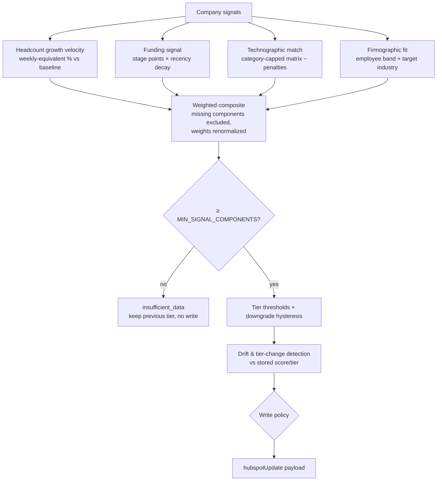

# n8n-hubspot-account-scoring-matrix-dynamic-recalculator

> Scheduled analytics pipeline that dynamically recalibrates account tiers and ICP fit scores based on weekly headcount shifts, funding events, and technographic updates.

Every Monday this n8n workflow reads company records from HubSpot (or a synthetic fixture in sandbox mode). It scores each account against a configurable ICP matrix, puts each account into `Tier 1` / `Tier 2` / `Tier 3` / `Unqualified`, and compares the result with last week's score and tier. It then writes only the changes that matter back to HubSpot through the batch update API and posts a Slack Block Kit summary for RevOps.

**Safe by default.** On import the workflow runs in `SANDBOX_MODE=true` and `DRY_RUN=true`, with `SCORE_UPDATE_ENABLED=false` and `SEND_SLACK_ALERTS=false`. A fresh install makes **zero external API calls** and **zero CRM writes**.

---

## Table of contents

1. [Architecture overview](#1-architecture-overview)
2. [Repository contents](#2-repository-contents)
3. [Prerequisites & HubSpot setup](#3-prerequisites--hubspot-setup)
4. [5-minute sandbox quick start](#4-5-minute-sandbox-quick-start)
5. [Step-by-step import & go-live guide](#5-step-by-step-import--go-live-guide)
6. [Environment variables](#6-environment-variables)
7. [Scoring algorithm matrix](#7-scoring-algorithm-matrix)
8. [Tiering, hysteresis, drift & write policy](#8-tiering-hysteresis-drift--write-policy)
9. [Slack alert anatomy](#9-slack-alert-anatomy)
10. [Safety matrix](#10-safety-matrix)
11. [Data protection & compliance checklist](#11-data-protection--compliance-checklist)
12. [RevOps best practices](#12-revops-best-practices)
13. [Troubleshooting](#13-troubleshooting)
14. [Disclaimer & license](#14-disclaimer--license)

---

## 1. Architecture overview

| Stage | Node(s) | What it does |
|---|---|---|
| Trigger | `Weekly Monday Schedule`, `Manual Test Trigger` | Cron `0 6 * * 1` (Mondays 06:00, workflow timezone UTC), or on-demand testing. |
| Config & safety | `Config & Safety Gate` | Reads every setting from `$env`, validates thresholds, normalizes weights, resolves the effective write mode. Stores only *presence booleans* for secrets. |
| Data source router | `Sandbox Mode?` → `Load Synthetic Fixture` **or** `HubSpot: List Companies` | Sandbox: embedded synthetic fixture. Live: paginated read-only `GET /crm/v3/objects/companies`. |
| Normalization | `Normalize Company Signals` | Converts fixture/live pages into typed company signal records. De-duplicates them, skips archived records and applies the optional scope filter. |
| Scoring engine | `Account Scoring & Tier Recalibration Engine` | Four-component weighted score, tier assignment with hysteresis, drift and tier-change detection, write decision and payload. |
| Write builder | `Build HubSpot Batch Payloads` | Chunks of ≤100 inputs for `/crm/v3/objects/companies/batch/update`, plus circuit breakers. |
| Write gate | `Live Write Enabled?` → `HubSpot: Batch Update Companies` **or** `Simulate Write (Dry Run)` | Live POST only when every safety condition passes; otherwise a HubSpot-shaped simulated response. |
| Reconciliation | `Collect Write Results` | Handles HTTP 200, 207 multi-status, and request failures in one write summary. |
| Alerting | `RevOps Summary & Slack Builder` → `Send Slack Alert?` → `Slack: Post Block Kit Alert` **or** `Slack Preview (Dry Run)` | Block Kit message covering upgrades, downgrades, average shift, top movers, data gaps and the write result. |
| Audit | `Execution Summary & Audit` → `Send Audit Webhook?` → `Audit Webhook: POST Summary` | Secret-free JSON audit record. It can optionally be sent to `ALERT_WEBHOOK_URL`. |

### Data flow

```mermaid
flowchart LR
    A1([Weekly Monday Schedule<br/>cron 0 6 * * 1]) --> B
    A2([Manual Test Trigger]) --> B
    B[Config & Safety Gate<br/>env → config, safe defaults] --> C{Sandbox Mode?}
    C -- true --> D1[Load Synthetic Fixture<br/>companies 44001–44005]
    C -- false --> D2[HubSpot: List Companies<br/>GET /crm/v3/objects/companies<br/>paginated, read-only]
    D1 --> E[Normalize Company Signals]
    D2 --> E
    E --> F[Account Scoring &<br/>Tier Recalibration Engine]
    F --> G[Build HubSpot Batch Payloads<br/>≤100 per batch + circuit breakers]
    G --> H{Live Write Enabled?}
    H -- true --> I1[HubSpot: Batch Update Companies<br/>POST /crm/v3/objects/companies/batch/update]
    H -- false --> I2[Simulate Write - Dry Run]
    I1 --> J[Collect Write Results]
    I2 --> J
    J --> K[RevOps Summary & Slack Builder<br/>Block Kit]
    K --> L{Send Slack Alert?}
    L -- true --> M1[Slack: Post Block Kit Alert]
    L -- false --> M2[Slack Preview - Dry Run]
    M1 --> N[Execution Summary & Audit]
    M2 --> N
    N --> O{Send Audit Webhook?}
    O -- true --> P[Audit Webhook: POST Summary]
```



### Scoring pipeline (per account)



---

## 2. Repository contents

```
n8n-hubspot-account-scoring-matrix-dynamic-recalculator/
├── workflow.json                                   # Importable n8n workflow (22 nodes incl. 2 sticky notes)
├── README.md                                       # This document
├── DISCLAIMER.md                                   # Liability limitation disclaimer
├── LICENSE                                         # MIT License
└── sample-payloads/
    └── hubspot-account-scoring-fixture.json        # Synthetic HubSpot Companies API page (sandbox data)
```

The fixture is also embedded in the `Load Synthetic Fixture` node, so sandbox runs need no file access. If you edit the sample file, paste the same JSON into that node's `FIXTURE` constant as well.

---

## 3. Prerequisites & HubSpot setup

### Platform

| Requirement | Notes |
|---|---|
| n8n | Self-hosted or n8n Cloud, **v1.30+** (uses Code node v2, IF node v2, HTTP Request node v4.2, Schedule Trigger v1.2). |
| Env access in nodes | `N8N_BLOCK_ENV_ACCESS_IN_NODE=false` on self-hosted. Newer n8n releases block `$env` by default. If access is blocked, the workflow falls back to sandbox + dry-run and adds a warning. |
| HubSpot | Any hub tier that supports Private Apps and custom company properties. Use a **developer test account or sandbox portal** first. |
| Slack (optional) | An Incoming Webhook for your RevOps channel. |

### HubSpot Private App scopes

Create a Private App (**Settings → Integrations → Private Apps**) and grant **only** these scopes:

| Scope | Why |
|---|---|
| `crm.objects.companies.read` | List companies and read signal and score properties. |
| `crm.objects.companies.write` | Batch-update score, tier and timestamp properties. Leave it off the token you use in dry-run mode if you want read-only enforcement at the API level. |

> 💡 Least-privilege tip: use **two** Private Apps, a read-only one for dry-run validation and a read/write one for production. Swap `HUBSPOT_ACCESS_TOKEN` when you go live.

### Company properties

Create these custom company properties (**Settings → Properties → Company properties**), or point the `HS_PROP_*` variables at properties you already have.

**Input signals (populated by your enrichment provider, import, or another workflow):**

| Internal name | Type | Example | Purpose |
|---|---|---|---|
| `numberofemployees` | *(standard)* number | `432` | Current headcount. |
| `industry` | *(standard)* enumeration | `LOGISTICS_AND_SUPPLY_CHAIN` | Industry match. |
| `latest_funding_stage` | dropdown | `seed`, `series_a`, `series_b`, `series_c`, `series_d_plus`, `ipo`, `none` | Funding stage signal. Common variants such as "Series A" are normalized. |
| `latest_funding_date` | date picker | `2026-10-02` | Funding recency. |
| `latest_funding_amount_usd` | number | `38000000` | Shown in the audit only; not scored by default. |
| `technographic_stack` | multiple checkboxes (or `;`-separated text) | `hubspot;aws;segment` | Technographic match. |
| `icp_scoring_enabled` *(optional)* | single checkbox | `true` | Scope filter when `SCORING_SCOPE_PROPERTY` is set. |

**Maintained by this workflow:**

| Internal name | Type | Written value |
|---|---|---|
| `icp_fit_score` | number | Composite score 0–100 (1 decimal). |
| `icp_account_tier` | dropdown: `tier_1`, `tier_2`, `tier_3`, `unqualified` | Recalibrated tier. |
| `icp_last_recalculated_at` | date & time | ISO timestamp of the run. |
| `icp_score_delta` | number | Change vs the previous stored score. |
| `icp_score_breakdown` | single-line text | e.g. `HC:100\|FD:85\|TG:100\|FM:100\|DC:100%` |
| `icp_headcount_baseline` | number | Headcount at the time of this write; next week's growth baseline. |
| `icp_headcount_baseline_date` | date picker | Date of the baseline (`YYYY-MM-DD`). |

> HubSpot also ships a standard **Ideal customer profile tier** property (`hs_ideal_customer_profile`) with `tier_1`/`tier_2`/`tier_3` values. To write there instead, set `HS_PROP_ACCOUNT_TIER=hs_ideal_customer_profile`. Note that it has no `unqualified` option, so either add one or keep the custom property.

---

## 4. 5-minute sandbox quick start

No HubSpot account, token or Slack webhook is needed.

1. **Import.** In n8n go to **Workflows → Add workflow → ⋯ → Import from File…** and select `workflow.json`.
2. **Leave every environment variable unset.** The defaults are sandbox + dry-run.
   *(Self-hosted: make sure `N8N_BLOCK_ENV_ACCESS_IN_NODE=false`, or the run still works but adds a warning.)*
3. **Click "Test workflow"** (Manual Test Trigger).
4. **Inspect the results:**
   - `Account Scoring & Tier Recalibration Engine` shows the per-account breakdown.
   - `Build HubSpot Batch Payloads` shows the exact batch body that *would* be sent.
   - `Slack Preview (Dry Run)` holds the `slackPayload`. Paste `blocks` into [Slack Block Kit Builder](https://app.slack.com/block-kit-builder) to see the message.
   - `Execution Summary & Audit` holds the full audit record.

**Expected sandbox outcome** (reference date `2026-11-16`, default weights):

| ID | Company (fictional) | Prev score / tier | New score | New tier | Change | Written? |
|---|---|---|---|---|---|---|
| 44001 | Apex Logistics | 64.2 / Tier 2 | **95.5** | Tier 1 | ⬆️ upgrade (+31.3) | simulated (`tier_change`) |
| 44002 | Vanguard Cloud | 79.0 / Tier 2 | **75.8** | Tier 2 | unchanged (−3.2, below drift threshold) | no (`no_material_change`) |
| 44003 | Brightfield Robotics | 58.5 / Tier 2 | **13.7** | Unqualified | ⬇️ downgrade (−44.8) | simulated (`tier_change`) |
| 44004 | Cobalt Harbor Health | — / — | **78.0** | Tier 2 | 🆕 initial | simulated (`first_score`) |
| 44005 | Lumen Ridge Retail | 41.0 / Tier 3 | — | Tier 3 (kept) | insufficient data (15% completeness) | no (`insufficient_data`) |

Write summary: `status: simulated`, `simulatedWrites: 3`, `writeMode: sandbox`. No HTTP request leaves n8n.

---

## 5. Step-by-step import & go-live guide

Promote one stage at a time and check each run before moving on.

| Stage | Settings | What happens | Exit criteria |
|---|---|---|---|
| **0. Sandbox** | defaults | Fixture only, no network. | Results table above reproduced. |
| **1. Tune** | sandbox + adjust `WEIGHT_*`, `TIER_*`, matrices | Fixture rescored with your matrix. | RevOps signs off on the weights and thresholds. |
| **2. Live read, dry run** | `SANDBOX_MODE=false`, `HUBSPOT_ACCESS_TOKEN` (read-only app), `DRY_RUN=true` | Real companies read and scored; writes simulated. | Score distribution looks sane; data-quality flags reviewed. |
| **3. Slack rehearsal** | stage 2 + `SEND_SLACK_ALERTS=true`, `SLACK_SCORING_WEBHOOK_URL`, and briefly `DRY_RUN=false` with `SCORE_UPDATE_ENABLED=false` | Slack posts, CRM writes still off (`updates_disabled`). | Message renders correctly in the target channel. |
| **4. Live writes** | `DRY_RUN=false`, `SCORE_UPDATE_ENABLED=true`, read/write token | Batch updates written to HubSpot. | Spot-check 10 records in HubSpot; audit status `completed`. |
| **5. Schedule** | Activate the workflow | Runs every Monday 06:00 (workflow timezone). | First scheduled run audited. |

**Detailed steps:**

1. **Create properties** from §3 in a test portal.
2. **Create the Private App**, copy the access token, and store it only as an environment variable on the n8n host. For n8n Cloud, use the instance's environment variable settings, or replace the `Authorization` header with a HubSpot credential (see §13).
3. **Set environment variables** (see §6) and restart n8n so `$env` picks them up.
4. **Adjust the schedule** if needed: open `Weekly Monday Schedule` and change the cron, or change **Workflow settings → Timezone**. The default is `UTC`.
5. **Run manually** at each stage and check `Execution Summary & Audit → audit.safety.effectiveWriteMode`.
6. **Activate** the workflow only after stage 4 passes.

---

## 6. Environment variables

### Safety & credentials

| Variable | Default | Description |
|---|---|---|
| `SANDBOX_MODE` | `true` | `true` = synthetic fixture, no HubSpot calls, writes impossible. |
| `DRY_RUN` | `true` | `true` = simulate all writes and suppress Slack and audit webhooks. |
| `SCORE_UPDATE_ENABLED` | `false` | Must be `true` for any HubSpot write. |
| `SEND_SLACK_ALERTS` | `false` | Must be `true` (and `DRY_RUN=false`) to post to Slack. |
| `SEND_AUDIT_WEBHOOK` | `false` | Must be `true` (and `DRY_RUN=false`) to POST the audit JSON. |
| `HUBSPOT_ACCESS_TOKEN` | — | Private App token. Used only in HTTP node headers via `{{ $env.HUBSPOT_ACCESS_TOKEN }}`. |
| `SLACK_SCORING_WEBHOOK_URL` | — | Slack Incoming Webhook URL. |
| `ALERT_WEBHOOK_URL` | — | Optional endpoint for the audit summary (e.g. a log collector or another n8n webhook). |
| `HUBSPOT_PORTAL_ID` | `99000001` | Used only to build record links in Slack. Placeholder by default. |
| `HUBSPOT_API_BASE_URL` | `https://api.hubapi.com` | API base URL. |

### Run-size guards

| Variable | Default | Description |
|---|---|---|
| `MAX_WRITES_PER_RUN` | `500` | Blocks every write if more updates than this are queued. |
| `MAX_TIER_CHANGE_RATIO` | `0.35` | Blocks writes if more than this share of previously tiered accounts change tier. |
| `CIRCUIT_BREAKER_MIN_SAMPLE` | `20` | The ratio breaker applies only once this many accounts have a previous tier. |
| `HUBSPOT_BATCH_SIZE` | `100` | Inputs per batch request (HubSpot max 100). |
| `HUBSPOT_PAGE_SIZE` | `100` | Records per list page (max 100). The list node fetches at most 50 pages. |
| `SCORING_SCOPE_PROPERTY` | *(empty)* | If set (e.g. `icp_scoring_enabled`), only companies where this property is true are scored. |

### Scoring weights & thresholds

| Variable | Default | Description |
|---|---|---|
| `WEIGHT_HEADCOUNT_GROWTH` | `0.30` | Weight of the headcount velocity component. |
| `WEIGHT_FUNDING` | `0.30` | Weight of the funding component. |
| `WEIGHT_TECHNOGRAPHIC` | `0.25` | Weight of the technographic component. |
| `WEIGHT_FIRMOGRAPHIC` | `0.15` | Weight of the firmographic component. |
| `TIER_1_MIN_SCORE` | `80` | Tier 1 threshold. |
| `TIER_2_MIN_SCORE` | `60` | Tier 2 threshold. |
| `TIER_3_MIN_SCORE` | `40` | Tier 3 threshold; below it is `Unqualified`. |
| `TIER_HYSTERESIS_POINTS` | `3` | A downgrade needs the score to fall this far *below* the current tier floor. |
| `SCORE_DRIFT_THRESHOLD` | `5` | Absolute score change that counts as drift and triggers a write. |
| `MIN_SIGNAL_COMPONENTS` | `2` | Minimum available components required to score an account. |
| `STALE_SCORE_REFRESH_DAYS` | `28` | Rewrite unchanged scores older than this so timestamps stay fresh. |
| `WRITE_POLICY` | `changes_only` | `changes_only` or `all` (write every scored account). |
| `SCORING_REFERENCE_DATE` | *(empty)* | ISO date that overrides "now" for backtests. Sandbox uses the fixture's `asOf`. |

### Signal tuning

| Variable | Default | Description |
|---|---|---|
| `HEADCOUNT_GROWTH_CEILING_PCT` | `3` | Weekly growth % that earns 100 points. |
| `HEADCOUNT_DECLINE_FLOOR_PCT` | `-3` | Weekly decline % that earns 0 points. |
| `HEADCOUNT_FLAT_SCORE` | `40` | Points for 0% growth. |
| `HEADCOUNT_MAX_BASELINE_AGE_DAYS` | `35` | Older baselines are ignored as stale. |
| `FUNDING_STAGE_POINTS_JSON` | see §7 | JSON map of stage → points. |
| `FUNDING_FULL_CREDIT_DAYS` | `90` | Full credit for rounds up to this age. |
| `FUNDING_DECAY_DAYS` | `540` | Age at which credit reaches the floor. |
| `FUNDING_FLOOR_MULTIPLIER` | `0.15` | Minimum recency multiplier. |
| `FUNDING_UNKNOWN_DATE_MULTIPLIER` | `0.5` | Multiplier when the stage is known but the date is not. |
| `TECH_MATRIX_JSON` | see §7 | JSON map of category → { tech: points }. |
| `ICP_EMPLOYEE_MIN` / `ICP_EMPLOYEE_MAX` | `50` / `2000` | ICP employee band. |
| `ICP_TARGET_INDUSTRIES` | `LOGISTICS_AND_SUPPLY_CHAIN,COMPUTER_SOFTWARE,HOSPITAL_HEALTH_CARE,INFORMATION_TECHNOLOGY_AND_SERVICES` | Comma-separated HubSpot industry values. |
| `ICP_OFF_TARGET_INDUSTRY_SCORE` | `30` | Industry sub-score when there is no match. |

### Property mapping & Slack

| Variable | Default |
|---|---|
| `HS_PROP_ICP_SCORE` | `icp_fit_score` |
| `HS_PROP_ACCOUNT_TIER` | `icp_account_tier` |
| `HS_PROP_RECALCULATED_AT` | `icp_last_recalculated_at` |
| `HS_PROP_SCORE_DELTA` | `icp_score_delta` |
| `HS_PROP_SCORE_BREAKDOWN` | `icp_score_breakdown` |
| `HS_PROP_HEADCOUNT_BASELINE` | `icp_headcount_baseline` |
| `HS_PROP_HEADCOUNT_BASELINE_DATE` | `icp_headcount_baseline_date` |
| `HS_PROP_FUNDING_STAGE` | `latest_funding_stage` |
| `HS_PROP_FUNDING_DATE` | `latest_funding_date` |
| `HS_PROP_FUNDING_AMOUNT` | `latest_funding_amount_usd` |
| `HS_PROP_TECH_STACK` | `technographic_stack` |
| `SLACK_CHANNEL_LABEL` | `#revops-scoring` (display only) |
| `SLACK_MAX_LIST_ITEMS` | `8` |

### Sample `.env`

```dotenv
# ---------- n8n runtime ----------
N8N_BLOCK_ENV_ACCESS_IN_NODE=false
GENERIC_TIMEZONE=UTC

# ---------- Safety flags (safe defaults: keep as-is until go-live) ----------
SANDBOX_MODE=true
DRY_RUN=true
SCORE_UPDATE_ENABLED=false
SEND_SLACK_ALERTS=false
SEND_AUDIT_WEBHOOK=false

# ---------- Credentials (placeholders: never commit real values) ----------
HUBSPOT_ACCESS_TOKEN=replace-with-private-app-token
SLACK_SCORING_WEBHOOK_URL=https://hooks.example.com/slack/replace-me
ALERT_WEBHOOK_URL=https://hooks.example.com/audit/replace-me
HUBSPOT_PORTAL_ID=99000001

# ---------- Run-size guards ----------
MAX_WRITES_PER_RUN=500
MAX_TIER_CHANGE_RATIO=0.35
CIRCUIT_BREAKER_MIN_SAMPLE=20
SCORING_SCOPE_PROPERTY=icp_scoring_enabled

# ---------- Scoring matrix ----------
WEIGHT_HEADCOUNT_GROWTH=0.30
WEIGHT_FUNDING=0.30
WEIGHT_TECHNOGRAPHIC=0.25
WEIGHT_FIRMOGRAPHIC=0.15
TIER_1_MIN_SCORE=80
TIER_2_MIN_SCORE=60
TIER_3_MIN_SCORE=40
TIER_HYSTERESIS_POINTS=3
SCORE_DRIFT_THRESHOLD=5
MIN_SIGNAL_COMPONENTS=2
WRITE_POLICY=changes_only

# ---------- Optional JSON overrides (single line) ----------
# FUNDING_STAGE_POINTS_JSON={"seed":45,"series_a":65,"series_b":85,"series_c":100,"series_d_plus":80,"ipo":40,"none":0}
# TECH_MATRIX_JSON={"crm":{"hubspot":40,"salesforce":30},"cloud_hosting":{"aws":25,"gcp":25,"azure":25},"negative_signals":{"legacy_on_prem_crm":-25}}
```

> The workflow never writes the token or webhook URLs into execution data. Only `credentialsPresent: { hubspotAccessToken: true|false, … }` is recorded.

---

## 7. Scoring algorithm matrix

The composite score is a weighted mean of four 0–100 component scores:

```
composite = Σ (component_score × weight) / Σ (weights of AVAILABLE components)
```

If a component has no data, it is **excluded**, and the remaining weights are renormalized. `dataCompleteness` is the share of total weight that was available (e.g. 85% if technographics are missing). If fewer than `MIN_SIGNAL_COMPONENTS` are available, the account is marked `insufficient_data` and is not rescored.

### Component 1: Headcount growth velocity (default weight 30%)

`weeklyPct = ((current − baseline) / baseline × 100) ÷ (daysSinceBaseline / 7)`

The rate is normalized to a weekly equivalent. A two-week-old baseline (because last week had no write) is still compared fairly.

| Weekly growth | Points |
|---|---|
| ≥ +3.0% (`HEADCOUNT_GROWTH_CEILING_PCT`) | 100 |
| +1.5% | 70 |
| 0% | 40 (`HEADCOUNT_FLAT_SCORE`) |
| −1.5% | 20 |
| ≤ −3.0% (`HEADCOUNT_DECLINE_FLOOR_PCT`) | 0 |

Linear interpolation is used between points. The component is unavailable if current headcount or the baseline is missing, or if the baseline is older than 35 days.

### Component 2: Funding signal (default weight 30%)

`funding = stagePoints × recencyMultiplier`

| Stage | Points | | Round age | Multiplier |
|---|---|---|---|---|
| `seed` | 45 | | ≤ 90 days | 1.00 |
| `series_a` | 65 | | 90 → 540 days | linear 1.00 → 0.15 |
| `series_b` | 85 | | ≥ 540 days | 0.15 |
| `series_c` | 100 | | date unknown | 0.50 |
| `series_d_plus` | 80 | | | |
| `ipo` | 40 | | | |
| `none` | 0 | | | |

Series C peaks because, for a mid-market GTM motion, that is when buying committees and tooling budgets usually expand. Re-weight with `FUNDING_STAGE_POINTS_JSON` for your own motion.

### Component 3: Technographic match (default weight 25%)

Within each category only the **best** positive match counts, so stacking three clouds does not inflate the score. Negative signals are summed. The score is `raw ÷ maxPossible × 100`, clamped to 0–100.

| Category | Tech → points | Category max |
|---|---|---|
| `crm` | hubspot 40 · salesforce 30 · pipedrive 15 | 40 |
| `cloud_hosting` | aws 25 · gcp 25 · azure 25 | 25 |
| `data_stack` | snowflake 15 · segment 15 · bigquery 10 | 15 |
| `automation` | n8n 10 · zapier 5 · make 5 | 10 |
| `negative_signals` | legacy_on_prem_crm −25 | — |
| | **maxPossible** | **90** |

Technology values are matched case-insensitively after the HubSpot multi-checkbox value is split on `;`, and spaces become `_`.

### Component 4: Firmographic fit (default weight 15%)

| Part | Weight | Rule |
|---|---|---|
| Employee band | 60% | 100 inside `ICP_EMPLOYEE_MIN`–`ICP_EMPLOYEE_MAX`. Below: `employees ÷ min × 100`. Above: `max ÷ employees × 100` (floor 20). |
| Industry | 40% | 100 if in `ICP_TARGET_INDUSTRIES`, else `ICP_OFF_TARGET_INDUSTRY_SCORE` (30). |

### Worked example: Apex Logistics (44001, synthetic)

| Component | Inputs | Score | Weight | Contribution |
|---|---|---|---|---|
| Headcount | 410 → 432 in 7 days = +5.37%/wk | 100.0 | 0.30 | 30.0 |
| Funding | Series B (85) · 45 days old (×1.00) | 85.0 | 0.30 | 25.5 |
| Technographic | hubspot 40 + aws 25 + segment 15 + n8n 10 = 90/90 | 100.0 | 0.25 | 25.0 |
| Firmographic | 432 in band (100) · target industry (100) | 100.0 | 0.15 | 15.0 |
| **Composite** | | | | **95.5 → Tier 1** |

---

## 8. Tiering, hysteresis, drift & write policy

| Tier | Composite score | HubSpot value |
|---|---|---|
| Tier 1 | ≥ 80 | `tier_1` |
| Tier 2 | 60 – 79.9 | `tier_2` |
| Tier 3 | 40 – 59.9 | `tier_3` |
| Unqualified | < 40 | `unqualified` |

**Downgrade hysteresis.** Upgrades apply immediately. A downgrade applies only if the score falls more than `TIER_HYSTERESIS_POINTS` below the current tier's floor. For example, a Tier 2 account scoring 58.0 stays Tier 2 (`held_by_hysteresis`), but at 56.9 it drops. This stops accounts near a boundary from changing owner every week.

**Tier-change classes:** `initial`, `upgrade`, `downgrade`, `unchanged`, `held_by_hysteresis`, `insufficient_data`.

**Write policy (`changes_only`).** The account is written when the first matching rule below applies:

| Order | Reason | Condition |
|---|---|---|
| — | `insufficient_data` | Never written; the previous score and tier are preserved. |
| 1 | `first_score` | No previous tier or score. |
| 2 | `tier_change` | Upgrade or downgrade. |
| 3 | `score_drift` | `abs(scoreDelta) ≥ SCORE_DRIFT_THRESHOLD`. |
| 4 | `refresh_stale` | Last recalculation ≥ `STALE_SCORE_REFRESH_DAYS` ago. |
| — | `no_material_change` | Skipped, which saves API calls and keeps property history clean. |

`WRITE_POLICY=all` writes every scored account.

**Circuit breakers** (checked in `Build HubSpot Batch Payloads`). A tripped breaker sets `writeMode: blocked`, simulates the write, flags the Slack alert with 🛑, and sets the audit status to `completed_writes_blocked`:

- More queued writes than `MAX_WRITES_PER_RUN`.
- Tier-change ratio above `MAX_TIER_CHANGE_RATIO`, when at least `CIRCUIT_BREAKER_MIN_SAMPLE` accounts have a previous tier. This usually means an enrichment feed broke, for example headcount zeroed out across the board.

---

## 9. Slack alert anatomy

The Block Kit message contains:

1. **Header**: "📊 Weekly ICP Score & Tier Recalibration".
2. **Context**: mode badge (🧪 SANDBOX / 🔍 DRY RUN / 🟢 LIVE), run ID and reference date.
3. **Stats grid**: accounts evaluated, scored vs insufficient, upgrades, downgrades, average score shift (signed and absolute), and average composite.
4. **Tier distribution** with first-time and hysteresis counts.
5. **⬆️ Upgrades / ⬇️ Downgrades**: HubSpot record links, previous → new tier and score with delta.
6. **🆕 First-time scores**, **📈 Top movers**, and **🩺 Insufficient data** with the data-quality flags.
7. **Write result**: status, mode, attempted, succeeded and failed counts (or simulated count), circuit-breaker reason and first error.
8. **Warnings** from the config gate.

Lists are capped at `SLACK_MAX_LIST_ITEMS`, each text block is truncated below Slack's 3,000-character limit, and the message is capped at 50 blocks.

---

## 10. Safety matrix

| `SANDBOX_MODE` | `DRY_RUN` | `SCORE_UPDATE_ENABLED` | Token | HubSpot read | HubSpot write | Slack / audit webhook* |
|---|---|---|---|---|---|---|
| `true` *(default)* | `true` *(default)* | any | any | ❌ fixture | ❌ simulated | ❌ preview only |
| `true` | `false` | any | any | ❌ fixture | ❌ simulated (`sandbox`) | ✅ if enabled + URL set |
| `false` | any | any | ❌ missing | ⛔ run stops with a clear error | — | — |
| `false` | `true` | any | ✅ | ✅ read-only | ❌ simulated (`dry_run`) | ❌ preview only |
| `false` | `false` | `false` | ✅ | ✅ | ❌ simulated (`updates_disabled`) | ✅ if enabled + URL set |
| `false` | `false` | `true` | ✅ | ✅ | ✅ **live**, unless a circuit breaker trips (`blocked`) | ✅ if enabled + URL set |

\* Slack requires `SEND_SLACK_ALERTS=true` and `SLACK_SCORING_WEBHOOK_URL`. The audit webhook requires `SEND_AUDIT_WEBHOOK=true` and `ALERT_WEBHOOK_URL`.

**Other built-in protections:**

- Blocked `$env` access is treated as "everything unset", so the run is sandbox + dry-run.
- Invalid tier thresholds (non-descending, or out of 0–100) stop the run before anything is read.
- Fixture loading fails closed if it is somehow reached with `SANDBOX_MODE=false`.
- HTTP write and alert nodes retry 3× with backoff, then continue so failures are reported rather than lost. The read node retries and then **fails** the run, so partial data is never scored.
- Batch updates are idempotent (the same values are written on retry).

---

## 11. Data protection & compliance checklist

- [ ] Sandbox and dry-run validation completed in a **HubSpot developer test account or sandbox portal** before any production token is used.
- [ ] Private App scopes limited to `crm.objects.companies.read` and `crm.objects.companies.write`; the token is rotated on a schedule and on staff changes.
- [ ] Tokens and webhook URLs are stored **only** as environment variables or n8n credentials; none appear in workflow JSON, Git, tickets or chat.
- [ ] n8n execution data retention (`EXECUTIONS_DATA_MAX_AGE`, `EXECUTIONS_DATA_PRUNE`) is configured to match your data-retention policy. Executions contain company names and scores.
- [ ] Access to the n8n instance and its execution history is restricted to RevOps and admin roles.
- [ ] The Slack channel receiving alerts is private and limited to people with a business need.
- [ ] Enrichment sources (headcount, funding, technographics) are licensed for CRM storage and automated scoring under their terms.
- [ ] The scoring logic is documented and reviewed, and changes to weights or thresholds are versioned with a date and an approver.
- [ ] Scores and tiers are used for **account prioritization** only. They are not used for decisions with legal or similarly significant effects on individuals without human review (GDPR Art. 22 / CCPA considerations).
- [ ] Data-subject and record-deletion requests are honoured in HubSpot. This workflow keeps no separate copy except the n8n execution history.
- [ ] The audit webhook endpoint (if used) is HTTPS, authenticated, and inside your trust boundary.
- [ ] HubSpot API rate limits are respected. The list node uses a 250 ms page interval and max 50 pages, and batch writes use ≤100 inputs per call.

---

## 12. RevOps best practices

- **Version the matrix.** Store your production weights and thresholds in a dated change log. A tier change in HubSpot should always trace back to a known matrix version (the audit record includes `scoringConfig`).
- **Backtest before re-weighting.** Use `SCORING_REFERENCE_DATE` with dry-run to see how a new matrix would have tiered last quarter's closed-won accounts.
- **Calibrate against outcomes.** Each quarter, compare tier against win rate and sales-cycle length. Tier 1 should close noticeably better than Tier 3; if it doesn't, the weights are wrong.
- **Protect owner routing.** If tiers drive assignment workflows in HubSpot, keep hysteresis at 3 points or more and review downgrades before they trigger re-routing.
- **Watch data completeness.** A rising share of `insufficient_data` or low `dataCompleteness` usually means an enrichment feed problem, not a market change.
- **Keep the baseline honest.** The workflow writes `icp_headcount_baseline` on every account it writes. If another process overwrites `numberofemployees` mid-week, velocity is measured against the last *written* baseline, which is the intended behaviour.
- **Separate signal from decision.** Let this workflow own *score and tier*. Let humans or separate workflows own *actions* (sequences, owner changes, ad audiences).

---

## 13. Troubleshooting

| Symptom | Cause / fix |
|---|---|
| Warning: "Environment variable access is blocked" | Set `N8N_BLOCK_ENV_ACCESS_IN_NODE=false` and restart n8n. |
| `SANDBOX_MODE=false requires HUBSPOT_ACCESS_TOKEN` | The token env var is missing or empty in the n8n process environment. |
| HubSpot `401` | Token invalid or rotated. |
| HubSpot `403` | Missing `crm.objects.companies.read` or `crm.objects.companies.write` scope. |
| Batch `207` with `PROPERTY_DOESNT_EXIST` | Create the property from §3 or fix the `HS_PROP_*` mapping. |
| `INVALID_OPTION` on tier | The dropdown is missing `tier_1` / `tier_2` / `tier_3` / `unqualified` options. |
| Every account `insufficient_data` | The signal properties aren't populated or are misnamed; check `dataQualityFlags`. |
| Headcount component always `na` on the first live run | Expected: no baseline exists yet. It is written on the first run, and velocity appears from week 2. |
| Writes `blocked` | A circuit breaker tripped; read `guard.blockReason` in the audit. |
| Prefer n8n credentials over `$env` for HubSpot | In both HubSpot HTTP nodes, set Authentication → *Predefined Credential Type → HubSpot App Token* and delete the `Authorization` header. |
| More than 5,000 companies | Raise `maxRequests` in the `HubSpot: List Companies` pagination options, or narrow scope with `SCORING_SCOPE_PROPERTY`. |

---

## 14. Disclaimer & license

### ⚠️ Disclaimer & Liability Limitation

**Use at your own risk.** The code, workflows and scripts in this repository (`n8n-hubspot-account-scoring-matrix-dynamic-recalculator`) are provided for educational and architectural demonstration purposes.

- **No Liability:** The author and dhRobin Systems accept no responsibility or liability for any direct, indirect, incidental, or consequential damages that result from using, misusing, or deploying these scripts, including incorrect account scores, tier assignments, territory or owner routing, or CRM data changes.
- **No Warranty:** All software, n8n JSON blueprints, JavaScript modules and scoring configurations are provided "AS IS", without warranty of any kind, express or implied. This includes, but is not limited to, warranties of merchantability, fitness for a particular purpose, and non-infringement.
- **Production Testing Required:** Always test thoroughly in an isolated staging environment, such as a HubSpot developer test account or sandbox, with `SANDBOX_MODE=true` and `DRY_RUN=true` enabled, before you connect live HubSpot credentials or set `SCORE_UPDATE_ENABLED=true`. Treat every computed score and tier as a recommendation that a person must review before it drives routing, outreach or prioritization.
- **Third-Party APIs & Compliance:** You alone are responsible for complying with the terms of service, rate limits, data privacy regulations (GDPR/CCPA), and security policies of HubSpot, Slack, your enrichment providers and any connected services. That includes confirming you are licensed to store and process enrichment data, documenting how automated scoring is used, and reviewing every automatically updated record.

The full disclaimer is also available in [DISCLAIMER.md](DISCLAIMER.md).

### License

Released under the MIT License. Copyright (c) 2026 DH Robin (dhRobin Systems). See [LICENSE](LICENSE).

---

Full text: DISCLAIMER.md · Licensed under the MIT License. License: MIT © 2026 DH Robin (dhRobin Systems) · Provided as-is, see the disclaimer.
